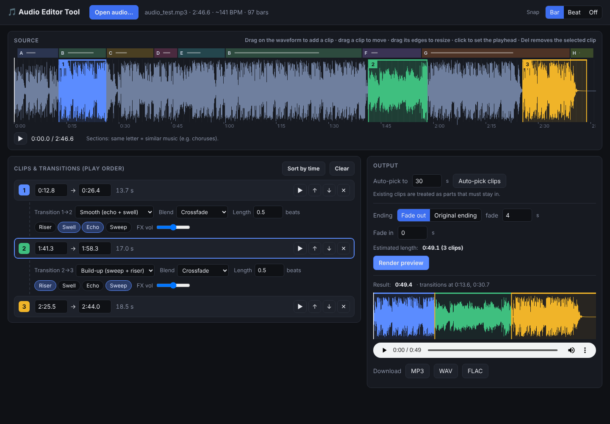

# Audio Editor Tool

Make short edits of a song with smooth, beat-matched transitions. Pick the parts you want in a visual editor (or let the tool pick them for a target length). It joins them on the beat with crossfades and DJ-style transition effects.



## Install

Requirements:

- [uv](https://docs.astral.sh/uv/getting-started/installation/)
- Python 3.12+ (uv can install it for you)
- [ffmpeg](https://ffmpeg.org/download.html) (optional) to read and export MP3/M4A. WAV, FLAC and OGG work without it.

```bash
git clone https://github.com/oskarsselis/audio-editor-tool.git
cd audio-editor-tool
uv sync
```

## Editor window

```bash
uv run audio-editor-tool-gui
```

This opens the editor in its own window. It uses Chrome/Edge app mode if one is installed, and otherwise your default browser. Everything runs locally on your computer.

1. Open or drop an audio file. The tool detects beats, bars and sections (same letter = similar music, e.g. choruses).
2. Add clips: drag on the waveform, or type start/end times. You can use as many clips as you like, from any part of the song, in any order.
3. Set each transition: pick a preset, or choose the blend, its length and effects yourself.
4. Choose the ending, then click **Render preview**, listen, and download MP3/WAV/FLAC.

### Options

| Option | What it does |
|---|---|
| **Snap: Bar / Beat / Off** | Clip edges lock to bar lines (smoothest), beats, or nothing. |
| **Clips** | Drag to add, move or resize. Edit times directly. Use ▶ to play a clip, ↑ ↓ to change the order and ✕ to delete one. **Sort by time** puts clips in song order. |
| **Transition preset** | **Smooth (echo + swell)** (default), **Clean cut**, **Build-up (sweep + riser)**, **DJ blend (bass swap)**, **Overlay**. |
| **Blend** | **Crossfade**: short fade that lands on the next downbeat. **DJ bass swap**: highs blend while the bass switches on the beat. **Overlay**: the next clip starts underneath the end of the previous one. |
| **Length** | Blend length in beats (4 = one bar). |
| **Effects** | **Riser**: a noise sweep that builds up. **Swell**: reverse reverb into the next clip. **Echo**: echoes of the last beat. **Sweep**: drains the bass before the cut. Combine them freely. **FX vol** sets their volume. |
| **Auto-pick** | Chooses clips for a target length. Clips already in the list are kept. |
| **Ending / Fade in** | Fade out (any length) or keep the song's real ending. Optional fade in. |

## Command line

```bash
# ~1:30 version, chosen automatically
uv run audio-editor-tool song.mp3 -l 1:30

# Must include 1:05–1:40, leave out 2:10–2:30
uv run audio-editor-tool song.mp3 -l 2:00 -k 1:05-1:40 -s 2:10-2:30 -o edit.mp3

# Your own parts, with echo + swell at the joins and a fade-out
uv run audio-editor-tool song.mp3 -p 1:41-1:58,2:25-2:44 --fx echo,swell --end fade

# Show the section map
uv run audio-editor-tool song.mp3 --analyze
```

Run `uv run audio-editor-tool --help` for all options: `--blend crossfade|eq|overlay`, `--xfade BEATS`, `--fx riser,swell,echo,sweep`, `--start`, `--end`, `--snap`, `--fade-out`, `--tolerance`, `--plan-json` and more.

## How it works

1. **Beats and bars**: librosa beat tracking. The downbeat is the beat with the strongest bass and chord changes, and the bar grid is extended over quiet intros and outros.
2. **Bar similarity**: harmony (per-beat chroma), timbre (MFCC) and loudness for every bar. This gives the section map and scores how seamless each possible cut is.
3. **Auto-pick**: dynamic programming over bars. It prefers phrase-aligned skips (multiples of 4 or 8 bars), cutting whole sections, few cuts, and choruses. Required parts are never skipped.
4. **Rendering**: cuts snap to the drum hit. Blends and effects are timed to the song's real beat grid, and a peak limiter prevents clipping.

## Project layout

```
src/audio_editor_tool/
  analysis.py   beats, bars, similarity, sections
  planner.py    automatic clip selection
  render.py     joining clips, blends, limiter
  fx.py         riser, swell, echo, sweep
  gui.py        local server for the editor window
  web/index.html  editor UI
  cli.py        command line
examples/make_demo_song.py   synthetic test song
tests/                       pytest suite (uv run pytest)
```

## Limitations

- Works best with a steady tempo and 4/4 time.
- Lyrics aren't understood: listen to the preview to check where vocal lines get cut.
- Clips must come from one song at a time.

## License

MIT
